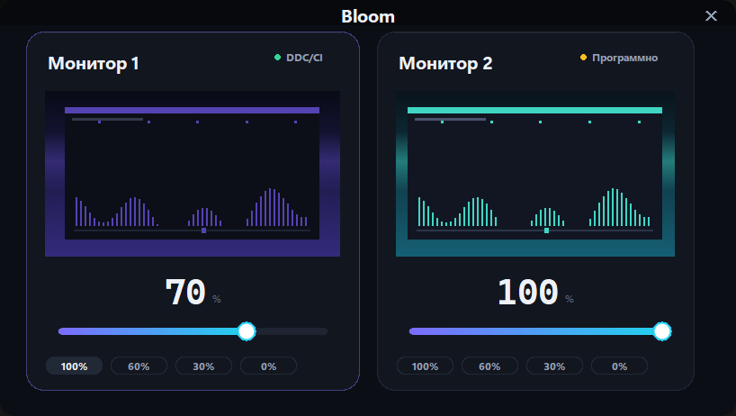

# Bloom

<p align="center">
  
</p>

**Bloom** — небольшое нативное приложение для Windows, которое меняет яркость
нескольких мониторов. По карточке на каждый экран: живое превью, отдельный
ползунок и пресеты. Тёмная тема — единственная.

---

## Возможности

* **Карточка на каждый монитор** — название, превью экрана, текущая яркость.
* **Два способа управления**, выбираются автоматически:
  * **DDC/CI** — настоящая аппаратная яркость (VCP 0x10). Монитор сам
    регулирует подсветку, изображение не темнеет, контраст сохраняется.
  * **Программный** — затемняющий оверлей поверх экрана. Используется, когда
    монитор не отвечает на DDC/CI.
* **Живое превью** — миниатюра экрана обновляется в реальном времени и показывает
  результат изменения яркости.
* **Управление по каждому монитору отдельно** — свой ползунок, своё значение
  и пресеты (100 / 60 / 30 / 0 %) в карточке каждого экрана.
* **Окно в размер содержимого** — ширина подстраивается под число мониторов.
* Никаких внешних зависимостей, никакой записи в реестр — только стандартная
  библиотека Python и Win32 API.

## Как это работает

| | DDC/CI | Программный режим |
|---|---|---|
| Что делает | Монитор меняет яркость подсветки сам | Поверх экрана появляется чёрный полупрозрачный слой |
| Диапазон | 0–100 % (шкала монитора) | 0–100 % |
| Изображение | Остаётся ярким, меняется только подсветка | Темнеет целиком, вместе с контрастом |
| Когда включается | Монитор отвечает на VCP 0x10 | Монитор не отвечает (например, DDC/CI выключен в OSD) |

Приложение само определяет режим и, если аппаратный канал в процессе работы
откажет, переключается на программный.

## Запуск

```bash
python bloom.py            # обычный режим
python bloom.py --demo     # демонстрация: вымышленные мониторы
```

Или дважды кликните `Запуск Bloom.bat`.

Готовый `.exe` лежит в `dist\Bloom.exe` (собран через PyInstaller) — запускается
без установки Python.

## Живое превью

Превью обновляется в реальном времени — частота кадров подбирается сама, чтобы
съёмка занимала не больше примерно пятой части процессорного времени
(на типичном компьютере это около 10 кадров в секунду и ~13 % одного ядра).

## Требования

* Windows 10 / 11
* Python 3.10+ с `tkinter` (в стандартной поставке Windows уже есть)

## Если монитор не реагирует на DDC/CI

Многие мониторы отключают DDC/CI в собственном меню (OSD). Обычно пункт
называется «DDC/CI» или «Внешний интерфейс» и находится в настройках монитора.
После включения перезапустите приложение — в карточке появится зелёная метка
**DDC/CI** вместо жёлтой **Программно**.

Аппаратная яркость доступна не всегда: часть видеокарт (в том числе NVIDIA на
Windows 10/11) блокирует управление гамма-кривой, поэтому запасной вариант
сделан через оверлей, а не через гамму.

## Диагностика

```bash
python probe_monitor.py
```

Показывает, какие мониторы найдены, что они сообщают по DDC/CI и какова шкала
яркости.

## Структура

```
bloom.py              точка входа
brightness_slider.py  совместимая точка входа (старое имя)
probe_monitor.py      диагностика мониторов
bloom_app/
    native.py          Win32: мониторы, DDC/CI, оверлей, снимки экрана
    displays.py        определение мониторов и EDID
    engine.py          движок яркости, выбор способа управления
    demo.py            демонстрационный режим и анимированные превью
    theme.py           палитра, шрифты, метрики
    widgets.py         карточки, ползунки, кнопки
    app.py             окно приложения
```

## Лицензия

MIT — см. [LICENSE](LICENSE).
